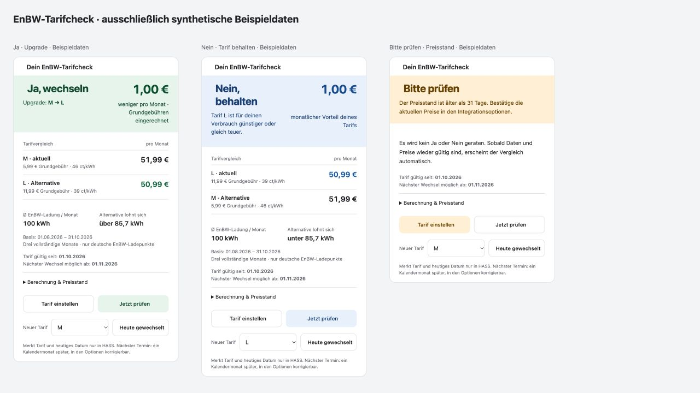

[](https://www.buymeacoffee.com/sluggyly1991)

# EnBW mobility+ Ladehistorie für Home Assistant

Eine **inoffizielle, nur lesende** Integration für Ladehistorie, Kosten, Monatswerte und besuchte Stationen. Vorhandene Belegungssensoren lassen sich über die EVSE-ID mit deinen besuchten Ladepunkten verbinden.

[Repository](https://github.com/sluggyly1991/enbw-mobilityplus-homeassistant) · [Releases](https://github.com/sluggyly1991/enbw-mobilityplus-homeassistant/releases) · [Fehler melden](https://github.com/sluggyly1991/enbw-mobilityplus-homeassistant/issues/new/choose) · [English documentation](README.md)

Dies ist ein Fork von [mawiak/enbw-mobilityplus-client](https://github.com/mawiak/enbw-mobilityplus-client), ergänzt um eine HASS-Integration. Der ursprüngliche Client und dessen MIT-Lizenz bleiben erhalten. Die Integration nutzt die veröffentlichte Version 1.0.0 als Abhängigkeit. Keine Verbindung zu EnBW; keine offizielle API oder Unterstützung durch EnBW.

## Farbige Tarifkarte (unveröffentlicht / main)

Eine Karte für den gesamten Tarifcheck: **Grün: Ja, wechseln**, **Blau: Nein, behalten**, **Gelb: Bitte prüfen**. Sie zeigt Upgrade oder Downgrade, monatlichen Preisunterschied inklusive Grundgebühren, beide Tarifpreise, Verbrauch und Wechselgrenze. Berechnungsdetails sind ausklappbar. Tarifauswahl und manuelles Aktualisieren sind direkt erreichbar. Die Karte folgt dem hellen/dunklen HASS-Theme und funktioniert auch in schmalen Dashboard-Spalten.



### Einbauen

Voraussetzung ist die Integration aus `main` mit dem Sensor **Tarifwechsel**; die Erweiterung ist noch nicht Teil des Tags `v0.3.0`.

1. [enbw-tariff-card.js herunterladen](https://raw.githubusercontent.com/sluggyly1991/enbw-mobilityplus-homeassistant/main/www/enbw-tariff-card.js) und als `/config/www/enbw-tariff-card.js` speichern; den Ordner bei Bedarf anlegen.
2. Unter **Einstellungen → Dashboards → Menü → Ressourcen** `/local/enbw-tariff-card.js?v=20261106-1` als **JavaScript-Modul** hinzufügen. Danach das Dashboard neu laden. Für Kartenupdates die Versionskennung in der Ressourcen-URL ändern.
3. **Karte hinzufügen → Manuell** öffnen und folgende Konfiguration einfügen. Beide Platzhalter durch die tatsächlichen Entity-IDs deiner Integration ersetzen:

```yaml
type: custom:enbw-tariff-card
entity: sensor.replace_with_tarifwechsel
refresh_entity: button.replace_with_history_refresh
language: de
```

`entity` ist der **Tarifwechsel**-Sensor, `refresh_entity` der Button **Historie aktualisieren**. Ohne `refresh_entity` wird die Aktualisieren-Taste ausgeblendet. Optional sind `title` für einen eigenen Titel und `language: en`. Die Karte nutzt vorhandene Berechnungssensoren; sie erkennt deinen Vertrag nicht selbst und ändert keinen Tarif. Keine zusätzlichen HACS-Karten oder externen Bibliotheken nötig; das JavaScript-Modul wird separat registriert und nicht automatisch durch den HACS-Download der Integration installiert.

### „Heute gewechselt“

In der Karte S, M oder L auswählen und **Heute gewechselt** drücken. Das speichert den gewählten Tarif, das heutige Datum und als nächsten Wechseltermin **einen Kalendermonat später** (z. B. 31. Januar → 28./29. Februar). Es wird nur die HASS-Konfiguration geändert, kein Vertrag bei EnBW.

Unter **Konfigurieren** sind **Tarif gültig seit** und **Nächster Wechsel möglich ab** editierbar. Das konkrete Datum aus der EnBW-App hat Vorrang vor dem Vorschlag. Ohne hinterlegte Daten bleibt der Termin unbekannt. Bei einer rechnerischen Ersparnis vor dem nächsten Wechseltermin zeigt die Karte gelb **Noch nicht wechseln** samt Datum; die Ersparnis wird weiterhin berechnet.

Die Aktion ist auch in Automationen verwendbar:

```yaml
action: enbw_mobilityplus.record_tariff_change
data:
  tariff: L
  # Bei mehreren Konten config_entry_id ergänzen.
```

[Komplettes Kartenbeispiel](examples/tariff-color-card.yaml) · [Markdown-Alternative ohne JavaScript](examples/tariff-card.yaml)

## Tarifcheck (unveröffentlicht / main)

Wähle deinen aktuellen **S-, M- oder L-Tarif** unter **Konfigurieren**. Die Integration prüft Upgrade und Downgrade gegen beide anderen Tarife und zeigt **Wechseln: Ja/Nein**, den günstigsten Alternativtarif, monatliche Nettoersparnis und Wechselgrenze. Die [native Dashboard-Karte](examples/tariff-card.yaml) benötigt keine Zusatzinstallation; ihre einzige Sensor-ID ersetzen.

Basis sind die letzten drei vollständigen Monate inklusive Nullmonaten und nur deutsche EnBW-Ladepunkte. Grundgebühren sind berücksichtigt. Preise werden manuell konfiguriert, nicht aus dem Konto erkannt; Vorgaben entsprechen den regulären Preisen vom 06.11.2026. Nach 31 Tagen ohne Preisbestätigung oder bei unvollständiger Historie lautet die Anzeige **Prüfen**. Ein vorhandener Datensatz vor dem Zeitraum ist eine konservative Abdeckungsprüfung; eine von EnBW still gekürzte Historie kann nicht erkannt werden. Es erfolgt kein automatischer Vertragswechsel. [Details und Kartenbeispiel](examples/README.md#tariff-comparison-card-unreleased--main).

## Installation mit HACS

Voraussetzung: Home Assistant **2026.3.0 oder neuer**, Internetzugang und ein unterstützter EnBW-Login. Die Anbindung wurde in Version 0.2.0 mit Home Assistant 2026.9.1 und echten Kontodaten geprüft. Die Prüfungen dieser Veröffentlichung laufen getrennt in GitHub Actions.

1. In **HACS → Menü → Benutzerdefinierte Repositories** `https://github.com/sluggyly1991/enbw-mobilityplus-homeassistant` als **Integration** hinzufügen.
2. **EnBW mobility+ History** herunterladen und HASS neu starten.
3. Unter **Einstellungen → Geräte & Dienste → Integration hinzufügen → EnBW mobility+** anmelden.

Die Aufnahme in den HACS-Standardkatalog ist ein eigener Prüfprozess. Bis zur Annahme ist das benutzerdefinierte Repository zu verwenden. In HASS-Versionen mit integriertem Marketplace dessen entsprechende Oberfläche verwenden.

Alternativ `custom_components/enbw_mobilityplus` nach `/config/custom_components/` kopieren, neu starten und wie oben anmelden. Bei einer bestehenden manuellen Installation den Ordner vorher sichern. Der vorhandene Integrationseintrag muss erhalten bleiben, damit Sensor-IDs und Einstellungen erhalten bleiben. Keine Änderungen an `configuration.yaml` nötig.

## Enthaltene Werte

- Letzte Ladung: kWh, Kosten, Beginn, Dauer, Betreiber, Adresse, Steckertyp, nomineller Preis, Blockiergebühr, Rabatt und mittlere Leistung.
- Monat, Vormonat, Jahr und erfasste Historie: Energie, Kosten, Ladeanzahl und energiegewichteter Effektivpreis.
- Besuchte Stationen: Summen, Koordinaten für die Karte und zugeordnete Live-Ladepunkte.
- Historie: jüngste 50 Datensätze als aktuelle Attribute; umfangreiche Listen werden nicht im Recorder aufgezeichnet.
- Aktualisieren-Button und letzte erfolgreiche Aktualisierung.

Die tatsächlichen Entity-IDs hängen von Sprache, Namen und Bereich ab. Die vier ursprünglichen Sensoren behalten ihre eindeutigen IDs. [Dashboard-Beispiele](examples/README.md) enthalten nur Platzhalter und benötigen keine zusätzlichen Karten. Die Installation verändert kein bestehendes Dashboard.

## Verknüpfung mit Belegungssensoren

Die vorhandene Stationsintegration liefert weiterhin die aktuelle Belegung. Ein kompatibler Sensor hat das Attribut `evse_id` und eine `options`-Liste mit `AVAILABLE`. Die EVSE-ID wird exakt gegen die besuchten Ladepunkte abgeglichen.

**Freie verknüpfte Ladepunkte sind nicht automatisch die freien Ladepunkte der gesamten Station.** Eine Station ohne passende Belegungssensoren hat keine Live-Abdeckung. Weitere öffentliche Stationen werden nicht automatisch eingerichtet. Umbenannte Sensor-IDs stören den EVSE-Abgleich nicht.

## Konfiguration und Aktionen

Unter **Konfigurieren** können Intervall (1–24 Stunden, Standard 6) und Abrufgrenze (25–10.000, Standard 1.000) eingestellt werden. Der Aktualisieren-Button erneuert die Sensorwerte.

Unter **Tools → Aktionen** (früher Entwicklerwerkzeuge) liefert

```yaml
action: enbw_mobilityplus.get_history
data:
  limit: 1000
```

eine aktuelle Antwort mit `sessions` und `limit_reached`. Bei mehreren Konten im Formular das Konto wählen (`config_entry_id`). Diese Aktion ändert weder die konfigurierte Abrufgrenze noch den Sensor-Zwischenspeicher.

```yaml
action: enbw_mobilityplus.get_stations
```

liefert zwischengespeicherte Stationssummen und verknüpfte Live-Ladepunkte. In Skripten ist für die Antworten eine `response_variable` anzugeben.

Zeiträume beziehen sich auf den Beginn der Ladung in der HASS-Zeitzone. Die Summen gelten nur für die erfassten Datensätze. `history_limit_reached: true` warnt vor einer erreichten Grenze; auch EnBW kann Daten begrenzen oder nachträglich korrigieren. Dies ist kein dauerhaftes Archiv und kein rückwirkender Import in die Energie-Statistik. Die mittlere Leistung wird aus Energie und Dauer berechnet, nicht live gemessen.

## Datenschutz und Grenzen

Anmeldedaten werden in der HASS-Konfiguration gespeichert und können in Backups enthalten sein. Token bleiben im Arbeitsspeicher. Historienantworten enthalten sensible Standort-, Kennungs- und Abrechnungsdaten. Keine unbereinigten Exporte oder HTTP-Debuglogs veröffentlichen. Diagnosen dieser Integration enthalten nur Mengen, Optionen und Status, keine Kontodaten oder Standorte.

Der Client unterstützt möglicherweise kein CAPTCHA, MFA oder Drittanbieter-Login. Er wählt derzeit das erste Kontoprofil; eine Profilwahl ist nicht implementiert. API-Änderungen können die Integration unterbrechen. Bei Anmeldeproblemen die von HASS angebotene erneute Authentifizierung nutzen. Für Sicherheitsmeldungen siehe [SECURITY.md](SECURITY.md).

Zum Entfernen den Integrationseintrag unter Geräte & Dienste löschen, danach die Integration in HACS deinstallieren beziehungsweise ihren Ordner entfernen und neu starten. Das EnBW-Konto wird dadurch nicht gelöscht.

## Entwicklung

[Mitwirken](CONTRIBUTING.md) · [HACS-Aufnahme](docs/HACS.md) · [MIT-Lizenz](LICENSE) · [Originaler Python-Client](docs/UPSTREAM_CLIENT.md)
