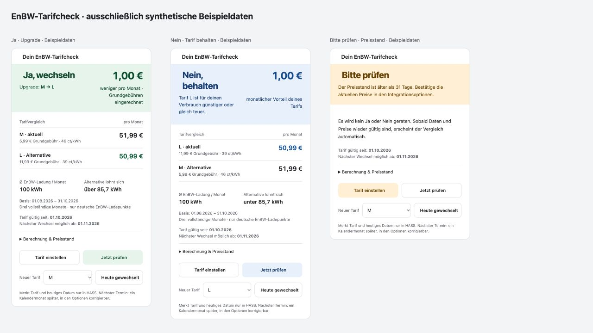

[](https://www.buymeacoffee.com/sluggyly1991)

# EnBW mobility+ History for Home Assistant

[](https://github.com/sluggyly1991/enbw-mobilityplus-homeassistant/actions/workflows/validate.yml)
[](https://github.com/sluggyly1991/enbw-mobilityplus-homeassistant/actions/workflows/tests.yml)
[](https://github.com/sluggyly1991/enbw-mobilityplus-homeassistant/releases)
[](LICENSE)

An **unofficial, read-only** Home Assistant integration for your EnBW mobility+ charging history. See charging costs and energy, compare months, map visited stations and link historical charging points to existing live availability sensors.

[Deutsche Anleitung](README.de.md) · [Installation](#installation) · [Releases](https://github.com/sluggyly1991/enbw-mobilityplus-homeassistant/releases) · [Report a bug](https://github.com/sluggyly1991/enbw-mobilityplus-homeassistant/issues/new/choose) · [HACS catalog](docs/HACS.md)

This project is a fork of [mawiak/enbw-mobilityplus-client](https://github.com/mawiak/enbw-mobilityplus-client), extended with a Home Assistant integration. The Python client source and its MIT attribution remain in this repository; the integration installs the published upstream client as a pinned dependency. Neither project is affiliated with or supported by EnBW. EnBW does not provide an official public account API; changes can break sign-in or data retrieval.

## Installation

### HACS search (recommended)

**EnBW mobility+ History is included in the HACS default catalog** since [9 November 2026](https://github.com/hacs/default/pull/13490). No custom repository is needed for normal installation.

1. Open **HACS** and search for **EnBW mobility+ History** (or **EnBW**).
2. Select the integration, download the latest release and restart Home Assistant.
3. Open **Settings → Devices & services → Add integration → EnBW mobility+**.
4. Enter your EnBW email and password.

If the project is not listed yet, refresh the HACS catalog and try again; newly accepted entries may need time to appear in your local catalog. No `configuration.yaml` changes are required. On Home Assistant versions with a built-in Marketplace, use its equivalent search interface.

### Custom repository (fallback)

Only if the project still does not appear in your HACS search:

1. Open **HACS → menu → Custom repositories**.
2. Add `https://github.com/sluggyly1991/enbw-mobilityplus-homeassistant` with category **Integration**.
3. Search for **EnBW mobility+ History**, download it, restart Home Assistant and configure it as above.

### Updating an existing installation

Download the update in HACS, then restart Home Assistant. **Keep your existing integration entry** to preserve account settings and entity unique IDs. The color card is a separate frontend module: install/update it using the [card instructions](#color-tariff-card), update its resource URL version and reload the dashboard. HACS updates of the integration do not automatically install or update that card file.

### Manual

Copy `custom_components/enbw_mobilityplus/` to `/config/custom_components/enbw_mobilityplus/`, restart, then add the integration as above. Back up an existing folder before replacing it. HACS can take over an existing manual installation using the same domain; keep the existing config entry.

## Color tariff card

One card combines the decision, upgrade/downgrade, monthly price difference including base fees, both tariff costs, average usage and break-even volume. **Green = switch, blue = stay, amber = check data/prices**. Calculation details expand on demand. Configure your tariff and refresh history from the card. It follows HA light/dark mode and fits narrow dashboard columns.



### Install the card

Requires integration **v0.4.0 or newer** with its **Tarifwechsel** decision sensor.

1. [Download enbw-tariff-card.js](https://raw.githubusercontent.com/sluggyly1991/enbw-mobilityplus-homeassistant/v0.4.0/www/enbw-tariff-card.js) to `/config/www/enbw-tariff-card.js` (create `www` if needed).
2. Under **Settings → Dashboards → menu → Resources**, register `/local/enbw-tariff-card.js?v=0.4.0` as a **JavaScript module**, then reload the dashboard. Change the resource URL version when updating the card.
3. Use **Add card → Manual**, replacing both entity placeholders with IDs from your integration:

```yaml
type: custom:enbw-tariff-card
entity: sensor.replace_with_tarifwechsel
refresh_entity: button.replace_with_history_refresh
language: en
```

`entity` is the **Tarifwechsel** decision sensor; `refresh_entity` is the **Historie aktualisieren** button. Omit `refresh_entity` to hide refresh. Optional: `title` and `language: de`/`en` (defaults to your HA language). No extra HACS card dependencies or external libraries. The module is registered separately; downloading the integration through HACS does not automatically install this frontend resource. It uses the configured comparison, never detects or changes your contract.

### “Switched today”

Choose S, M or L in the card and press **Switched today**. It records that tariff, today's local HA date and a proposed next switch date **one calendar month later**, clipped at month end (January 31 → February 28/29). This changes HA configuration only, never your EnBW contract.

The integration options expose **Tariff effective since** and **Next switch available on**. The actual date in the EnBW app overrides the proposal. Missing dates remain unknown. If an alternative is cheaper but the date has not arrived, the card shows amber **Wait before switching** and the date, while still calculating the potential saving.

The action is also available to automations:

```yaml
action: enbw_mobilityplus.record_tariff_change
data:
  tariff: L
  # Add config_entry_id when multiple accounts are configured.
```

[Full configuration example](examples/tariff-color-card.yaml) · [Native Markdown alternative](examples/tariff-card.yaml)

## Tariff comparison

Select your current **S, M or L tariff** in the integration options. Upgrade and downgrade comparisons expose a Yes/No decision (German Ja/Nein), best alternative, monthly net saving and break-even kWh. Use the [native dashboard card](examples/tariff-card.yaml), replacing its single sensor placeholder; no additional frontend dependency.

The last three complete calendar months include zero-use months and only German EnBW sessions. Both monthly fees are included. Prices are configurable and are not detected from your account; defaults are regular prices verified on 2026-11-06. After 31 days without price confirmation, or with insufficient history, the decision is **Prüfen** (check). Coverage requires an older session and a non-truncated response; a silently shortened provider archive cannot be detected. No contract is changed. [Calculation details](examples/README.md#tariff-comparison-card).

## Features

- UI setup with your EnBW email and password; reauthentication when needed.
- Latest charge: energy, cost, start, duration, operator, address, connector, nominal price, blocking fee, discount and calculated average power.
- Current month, previous month, current year and captured-history totals: energy, cost, session count and energy-weighted effective price.
- Visited stations grouped by address and operator, with map coordinates and per-station totals.
- **Live availability linking:** exact EVSE IDs connect visited charging points to compatible sensors already installed in Home Assistant. Availability changes update the linked station without fetching the history again.
- Manual refresh button; configurable refresh interval (1–24 hours, default 6) and history limit (25–10,000, default 1,000).
- Response actions for history and visited stations; count-only privacy-preserving diagnostics.
- German and English setup/options translations.

## Requirements

- Home Assistant **2026.3.0 or newer**. Version 0.2.0 was tested on 2026.9.1; CI validates the release separately.
- An EnBW mobility+ account with a login supported by the upstream client. CAPTCHA, MFA and third-party sign-in are not implemented.
- Internet access for the EnBW API and installation of `enbw-mobilityplus-client==1.0.0`.
- A compatible availability integration is **optional**. History and station totals work independently.


## Entities and dashboard

Entities belong to one EnBW account device. Home Assistant generates the actual entity IDs from your language, device, area and naming preferences. **Do not assume the IDs in examples match your installation.** The four sensors from 0.1/0.2 keep their unique IDs.

| Group | Values |
| --- | --- |
| Latest charge | kWh, EUR, timestamp, seconds, nominal ct/kWh, operator, address, connector, fee, discount, average kW |
| Month / previous month / year / captured history | kWh, EUR, number of charges, effective EUR/kWh |
| History | Number of captured sessions; latest 50 sessions and monthly totals as current attributes |
| Stations | Number of visited stations; one map-ready sensor per visited station with historical totals and matched live points |
| Refresh | Button and timestamp of the last successful history fetch |

See [dashboard examples](examples/README.md) to build a native dashboard without third-party cards. Examples contain placeholders only. Installing the integration does not change your dashboards or add a dashboard automatically.

### How live linking works

A compatible sensor must expose `evse_id` and an `options` attribute containing `AVAILABLE`. The station sensor links those whose EVSE ID appears in its history. `monitored_charge_points` and `available_charge_points` refer only to these **matched points**. They are not the total capacity of the station. A station without matched sensors has **no live coverage**, not a confirmed zero free chargers. Sensor entity IDs may be renamed without breaking EVSE-based matching.

Your existing station integration remains responsible for station discovery and its update interval. This integration does not duplicate its API polling or automatically configure new public stations.

### Meaning of totals

All periods use the **session start in Home Assistant's timezone**. Effective price is total cost divided by energy, not the mean of advertised prices. Average power is energy divided by session duration, not real-time charging power.

Totals cover **only the fetched history**. `history_limit_reached: true` signals possible truncation; increase the limit in the integration options. Provider-side retention can also limit availability. History attributes contain the latest 50 sessions; the full requested history is available through the action below. Large lists are excluded from Recorder; this is not a permanent archive or retrospective Recorder import.

These are discrete public charging sessions and period summaries, not a cumulative meter suitable for the Home Assistant Energy dashboard. Historic sessions and running totals may change if the provider corrects billing.

## Actions

In **Tools → Actions** (Developer Tools on older versions), run:

```yaml
action: enbw_mobilityplus.get_history
data:
  limit: 1000
```

Returns `sessions` and `limit_reached`. Limits are 1–10,000. With multiple accounts, select the account using the `config_entry_id` field. This action fetches fresh data but does not replace the coordinator's configured history window or the sensor cache.

```yaml
action: enbw_mobilityplus.get_stations
```

Returns cached station totals, matched live points and the history-limit flag. The optional `config_entry_id` selects an account. Both actions return response data; scripts must capture it using `response_variable`.

Use the **History refresh** button to update the sensors and cached history. Set the refresh interval and limit under the integration's **Configure** menu.

## Privacy and security

- Credentials are saved in Home Assistant config entries and may be included in backups. Tokens exist only in memory.
- History and action responses contain sensitive travel locations, identifiers and billing data. Do not paste unredacted exports into issues.
- The integration suppresses upstream exception bodies, which can contain tokens or authentication URLs. Avoid enabling HTTP debug logging when reporting issues.
- Diagnostics expose only counts, limits, intervals and update status. They omit credentials, profile IDs, EVSE IDs, addresses and coordinates.
- No telemetry or analytics are sent by this integration. Authentication/history requests go to the EnBW services used by the upstream client.

See [SECURITY.md](SECURITY.md) for responsible reporting.

## Troubleshooting

- **Cannot sign in:** verify the account in the official app; CAPTCHA/MFA may require changes in the upstream client.
- **Reauthentication requested:** follow the Home Assistant reauthentication flow. Never delete a working account entry merely to refresh a token.
- **Unavailable after a connection error:** check connectivity and try the refresh button after the API recovers.
- **Incomplete totals:** inspect `history_limit_reached` and the provider's available history.
- **No station availability:** verify matching `evse_id` attributes and a compatible existing availability sensor. A historical station alone cannot provide live status.
- **Several profiles:** the upstream client currently selects the first profile. Profile selection is not implemented.

To remove: delete the integration under Devices & services, then uninstall through HACS (or remove its custom component folder) and restart. This removes the connection; it does not delete your EnBW account.

## Development and contribution

See [CONTRIBUTING.md](CONTRIBUTING.md). HACS validation, hassfest, linting and automated offline tests run in GitHub Actions. CI never needs real EnBW credentials. Releases are created only after checks pass. The project was accepted into the HACS default catalog in [PR #13490](https://github.com/hacs/default/pull/13490). This remains an unofficial EnBW integration.

## Credits and license

- Original client: [Marc Szymkowiak / mawiak](https://github.com/mawiak/enbw-mobilityplus-client), MIT.
- Home Assistant integration and HACS packaging: [sluggyly1991](https://github.com/sluggyly1991).
- [Original client documentation](docs/UPSTREAM_CLIENT.md).
- [MIT license](LICENSE). EnBW and mobility+ are trademarks of their respective owners. The included charging icon identifies this community project and is not an official EnBW logo.
